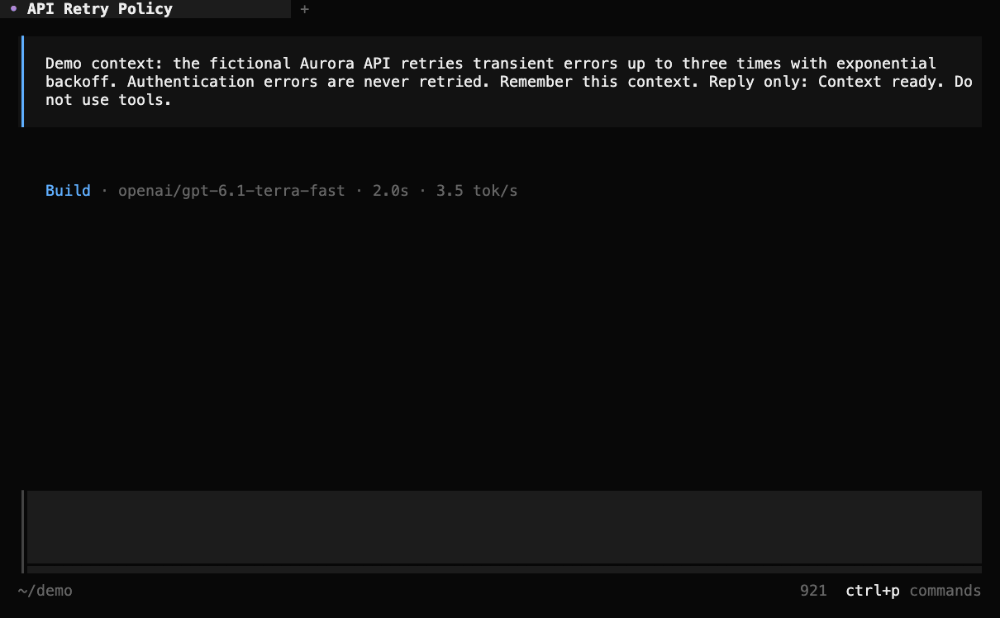

# BTW Side Chat for OpenCode

Ask a quick question about your OpenCode session without interrupting the main
conversation—and keep asking follow-ups in a separate side panel.



*Snapshots from a real, isolated OpenCode V2 session using fictional project
context; waiting time is shortened.*

## What it does

- Opens a multi-turn side conversation with `/btw` or `/btw <question>`.
- Uses the main session's current context and model without adding side
  messages to the main transcript or interrupting a running task.
- Keeps side histories separate for each main session, with local commands,
  prompt history, and OpenCode-style keyboard navigation.
- Uses the same non-mutating generation path as OpenCode's built-in `/btw`.
  Side requests do not execute tools.

The side chat is **temporary**: its history and drafts live in the terminal's
memory. They survive closing and reopening the panel and plugin reloads, but
not exiting the terminal.

## Requirements

- OpenCode **V2** terminal UI; tested with OpenCode 2.2.0.
- [Bun](https://bun.sh/) for installing dependencies and running checks;
  the project is tested with Bun 1.4.3.
- A working model configured in OpenCode. Side questions use that model and
  may incur provider usage. This plugin does not support OpenCode Desktop.

## Install

1. Clone the repository and install its dependencies:

   ```sh
   git clone https://github.com/elad12390/opencode-btw.git
   cd opencode-btw
   bun install --frozen-lockfile
   ```

2. Run `pwd` and add the resulting **absolute directory path** to the existing
   `plugins` array in `~/.config/opencode/cli.json`. Preserve any other settings
   and plugins already in the file:

   ```jsonc
   {
     "$schema": "https://opencode.ai/v2/cli.json",
     "plugins": ["/absolute/path/to/opencode-btw"]
   }
   ```

3. In an OpenCode terminal session, run `/reload` if needed, then type `/btw`.
   This plugin replaces the terminal's built-in one-shot `/btw` while enabled.
   Remove its entry from `cli.json` to restore the built-in command.

## Use

Type `/btw` to open the panel, or `/btw <question>` to open it and ask. Type a
follow-up in the side composer. It honors OpenCode's configured input bindings;
by default, Enter sends and Shift+Enter, Ctrl+Enter, Alt+Enter, or Ctrl+J adds a
line. You can also click **send**.

Type `/` in the side composer to see local command suggestions. Use OpenCode's
autocomplete keys (by default Up/Down, Enter/Tab, and Escape), or click one:

| Command | Action |
| --- | --- |
| `/help` | Open the searchable side-command picker. |
| `/clear` | Clear this side conversation after confirmation. |
| `/copy` | Send the latest answer to the terminal clipboard. |
| `/latest` | Jump to the newest side message. |
| `/expand` | Toggle split and fullscreen when the terminal is wide enough. |
| `/retry` | Retry the most recent failed side question. |
| `/close` | Close the panel without interrupting the main session. |

The command text is not sent to the model; `/retry` resends the failed side
question. Selecting a suggestion runs it. Otherwise, only an exact command is
executed: `/clear what does this mean?` or `/usr/local/bin` remains a side
question. Clearing is unavailable while a side request is running.

Up/Down at the edge of the input recalls side questions and restores your
unfinished draft when you return to the newest entry. Page Up/Down or the
mouse wheel scrolls the side conversation. Escape closes the panel; if a
selection or command menu is open, it dismisses that first. Reopen with `/btw`
to continue. Ctrl+R retries a failed question; Ctrl+L or `/btw-clear` clears
this session's side conversation after confirmation.

## Context, privacy, and caching

Every side question uses the main session's **current** context, which may have
advanced since the panel was opened. Earlier side exchanges are included in
later side requests but not added to the parent transcript. As with the main
session, the selected provider receives the context and question needed to
answer; don't send information you don't want that provider to process.

The plugin uses the main session's model and cache-routing identity and keeps
the parent context at the front of the request. A provider *may* reuse a
matching prompt cache, but a cache hit is not guaranteed. It depends on the
provider, model, prompt prefix, tool definitions, and cache lifetime. The
generation API does not expose cache-usage counters; verify actual cache
reads through provider usage data or server diagnostics.

## Development

```sh
bun install --frozen-lockfile
bun run typecheck
bun test
```

The tests exercise side-chat state, focus, commands, and the real OpenTUI
renderer without requiring model credentials. See [CONTRIBUTING.md](CONTRIBUTING.md)
and [SECURITY.md](SECURITY.md).

## License

[MIT](LICENSE). See [third-party notices](THIRD_PARTY_NOTICES.md) for attribution.
